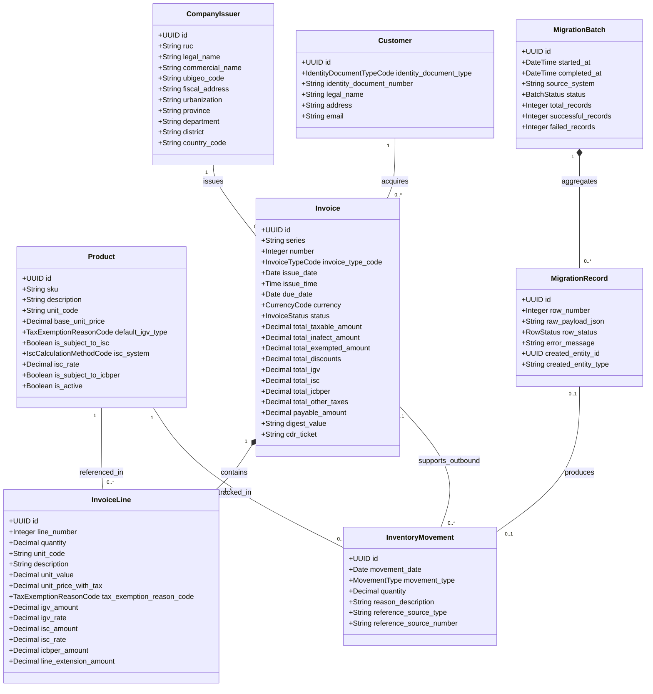
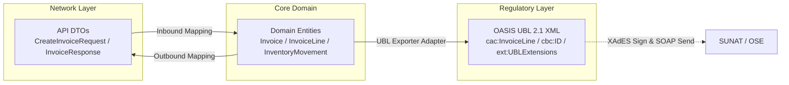

# SPEC 01 — Modelo de Dominio y Mapeo Legado

**Versión:** 1.0.0  
**Fecha:** 22 de octubre de 2026  
**Fase:** Fase 1 — Especificación Técnica Spec-First  
**Autor:** Senior Software Architect  
**Estado:** BORRADOR — PENDIENTE DE REVISIÓN

---

## 1. Introducción y Principios de Modelado

Este documento especifica el Modelo de Dominio de **ABC Software Corp**, diseñado bajo principios de Domain-Driven Design (DDD). Se establece una frontera estricta entre:
1. **Entidades del Dominio de Negocio (Domain Entities):** Representan la verdad operativa, contable y de almacén de la empresa con identidades y reglas invariantes. Los identificadores técnicos, clases y atributos se expresan en inglés estándar de ingeniería de software.
2. **DTOs (Data Transfer Objects):** Estructuras agnósticas de entrada/salida para las interfaces de aplicación y API REST.
3. **Estructuras de Documentos UBL 2.1 (OASIS):** Representaciones jerárquicas en XML/XSD para intercambio normativo con SUNAT/OSE, preservando los nombres exactos de OASIS (ej. `cbc:ID`, `cac:InvoiceLine`).

---

## 2. Entidades de Dominio, Atributos y Cardinalidades

### 2.1 Definición Detallada de Entidades

#### `CompanyIssuer` (Aggregate Root)
Representa a **ABC Software Corp** como sujeto tributario emisor de comprobantes electrónicos de pago.
- `ruc`: Cadena de 11 dígitos numéricos válidos.
- `legal_name`: Razón social registrada ante SUNAT.
- `commercial_name`: Nombre comercial de la empresa.
- `ubigeo_code`: Código de 6 dígitos según catálogo INEI.
- `fiscal_address`: Dirección del domicilio fiscal.
- `country_code`: Código ISO 3166-1 alfa-2 (`PE`).

#### `Customer` (Entity / Aggregate Root)
Adquirente de los bienes comercializados.
- `identity_document_type`: Código según Catálogo 06 SUNAT (`6` = RUC, `1` = DNI, etc.).
- `identity_document_number`: Número del documento. Para facturas (`01`), obligatorio RUC de 11 dígitos.
- `legal_name`: Razón social o nombres y apellidos completos.
- `address`: Dirección del adquirente.
- `email`: Correo para notificación electrónica.

#### `Product` (Entity / Aggregate Root)
Bien o mercadería de abarrotes comercializada.
- `sku`: Código único de control de inventario (ej. `ARR-COST-50K`).
- `description`: Descripción comercial del producto.
- `unit_code`: Código de unidad de medida según Catálogo 03 SUNAT / UN/ECE rec 20 (`NIU`, `KGM`, `BX`).
- `base_unit_price`: Valor unitario sin tributos.
- `default_igv_type`: Afectación al IGV por defecto según Catálogo 07 (`10` Gravado Oneroso).
- `is_subject_to_isc`: Indicador booleano de afectación al ISC.
- `isc_system`: Código del sistema de cálculo según Catálogo 08 (`01`, `02`, `03`).
- `isc_rate`: Tasa porcentual o monto unitario del ISC.
- `is_subject_to_icbper`: Indicador de impuesto a las bolsas plásticas.

#### `Invoice` (Aggregate Root)
Comprobante electrónico tipo Factura (`01`).
- `series`: Serie alfanumérica de 4 caracteres (ej. `F001`).
- `number`: Número correlativo entero (1 a 99999999).
- `invoice_type_code`: Código de tipo de documento (`01` Factura, Catálogo 01).
- `issue_date` / `issue_time`: Fecha y hora de emisión.
- `currency`: Código de moneda (`PEN`, `USD`, Catálogo 02).
- `status`: Estado del ciclo de vida (`DRAFT`, `VALIDATED`, `SIGNED_PENDING_SUBMISSION`, `ISSUED_ACCEPTED`, `REJECTED`, `OBSERVATIONS_DETECTED`, `VOIDED`).
- `payable_amount`: Importe total a pagar con redondeo a 2 decimales.

#### `InvoiceLine` (Entity)
Línea individual de detalle del comprobante.
- `line_number`: Número de orden secuencial (1..N).
- `quantity`: Cantidad vendida.
- `unit_value`: Valor monetario unitario sin impuestos.
- `tax_exemption_reason_code`: Código de afectación al IGV (Catálogo 07).
- `line_extension_amount`: Subtotal valor venta ($\text{quantity} \times \text{unit\_value}$).

#### `InventoryMovement` (Entity)
Registro físico de movimientos en almacén.
- `movement_date`: Fecha de ocurrencia del movimiento.
- `movement_type`: `INBOUND` (ingreso) o `OUTBOUND` (salida).
- `quantity`: Cantidad física de mercadería.
- `reference_source_type`: Tipo de documento de referencia (`INTERNAL_LEGACY_RECORD`, `COMMERCIAL_INVOICE`, `DESPATCH_ADVICE`).
- `reference_source_number`: Identificador del documento de origen.

#### `MigrationBatch` & `MigrationRecord` (Aggregate Root / Entity)
Ingesta masiva y auditoría de datos históricos legados.
- `MigrationBatch`: Control general de ejecución batch con contadores y fechas.
- `MigrationRecord`: Mantiene intacto el `raw_payload_json` y vincula al movimiento creado.

---

## 3. Mapeo y Trazabilidad del Sistema Legado

Los 5 campos del sistema anterior se mapean hacia el nuevo modelo como sigue:

| Campo Legado | Tipo Detectado | Entidad Destino | Atributo Destino | Regla de Transformación y Normalización |
| :--- | :--- | :--- | :--- | :--- |
| `fecha` | Texto / Fecha informal | `InventoryMovement` | `movement_date` | Normalización hacia formato ISO 8601 (`YYYY-MM-DD`). Validación estricta de fecha calendario. |
| `ingreso` | Numérico o Cadena | `InventoryMovement` | `movement_type = INBOUND`, `quantity` | Si `ingreso > 0` y `salida == 0`: movimiento `INBOUND`. Si ambos son positivos, marca de inconsistencia. |
| `salida` | Numérico o Cadena | `InventoryMovement` | `movement_type = OUTBOUND`, `quantity` | Si `salida > 0` y `ingreso == 0`: movimiento `OUTBOUND`. |
| `producto` | Cadena informal | `Product` / `InventoryMovement` | `sku`, `description` | Búsqueda por SKU o denominación. Si no existe, se cataloga como producto no homologado. |
| `nro_documento`| Cadena alfanumérica | `InventoryMovement` | `reference_source_number` | **REGLA CRÍTICA:** Se preserva en `reference_source_number` con `reference_source_type = 'INTERNAL_LEGACY_RECORD'`. **No genera serie ni correlativo formal de Factura SUNAT.** |

---

## 4. Distinción Arquitectónica: Dominio vs DTO vs UBL 2.1

- **Modelo de Dominio:** Entidades fuertemente tipadas en inglés con invariantes, estados y precisión numérica (`BigDecimal`).
- **DTOs:** Esquemas agnósticos JSON definidos en `specs/03-dtos-schemas.yaml`.
- **Estructuras UBL 2.1:** Etiquetas XML nativas de OASIS UBL Invoice 2.1 (`cac:AccountingSupplierParty`, `cac:TaxTotal`, `cac:LegalMonetaryTotal`).
