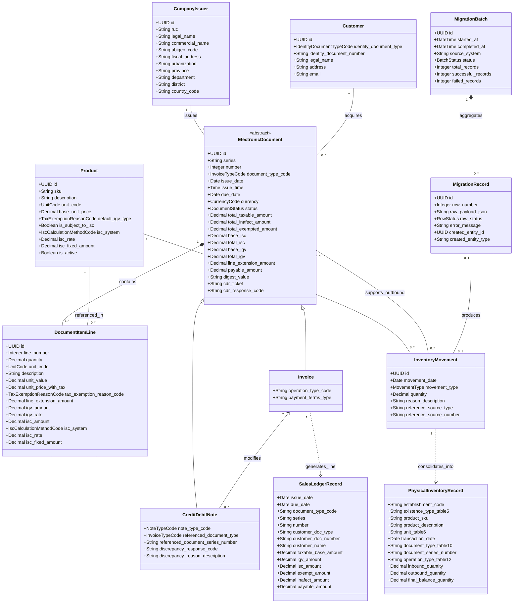
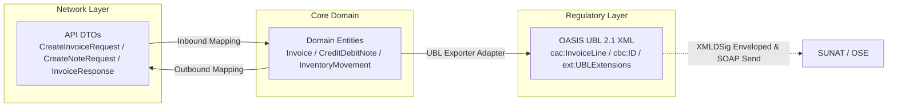

# SPEC 01 — Modelo de Dominio y Mapeo Legado

**Versión:** 2.0.0  
**Fecha:** 5 de noviembre de 2026  
**Fase:** Fase 2 — Corrección y Ampliación Spec-First  
**Autor:** Senior Software Architect  
**Estado:** REVISADO — APROBADO PARA FASE 2

---

## 1. Introducción y Principios de Modelado

Este documento especifica el Modelo de Dominio de **ABC Software Corp**, diseñado bajo principios de Domain-Driven Design (DDD). Se establece una frontera estricta entre:
1. **Entidades del Dominio de Negocio (Domain Entities):** Representan la verdad operativa, tributaria y de almacén de la empresa con identidades y reglas invariantes. Los identificadores técnicos, clases y atributos se expresan en inglés estándar de ingeniería de software.
2. **DTOs (Data Transfer Objects):** Estructuras agnósticas de entrada/salida para las interfaces de aplicación y API REST.
3. **Estructuras de Documentos UBL 2.1 (OASIS):** Representaciones jerárquicas en XML/XSD para intercambio normativo con SUNAT/OSE, preservando los nombres exactos de OASIS (ej. `cbc:ID`, `cac:InvoiceLine`, `cac:CreditNoteLine`).

---

## 2. Entidades de Dominio, Atributos y Cardinalidades

---

## 3. Definición Detallada de Entidades y Reglas Invariantes

### 3.1 `CompanyIssuer` (Aggregate Root)
Representa a **ABC Software Corp** como sujeto tributario emisor de comprobantes electrónicos de pago.
- `ruc`: Cadena de 11 dígitos numéricos válidos (prefijo 20, verificación Módulo 11).
- `legal_name`: Razón social registrada ante SUNAT (`ABC SOFTWARE CORP S.A.C.`).
- `commercial_name`: Nombre comercial de la empresa.
- `ubigeo_code`: Código de 6 dígitos según catálogo INEI.
- `fiscal_address`: Dirección del domicilio fiscal.
- `country_code`: Código ISO 3166-1 alfa-2 (`PE`).

### 3.2 `Customer` (Entity / Aggregate Root)
Adquirente de los bienes comercializados.
- `identity_document_type`: Código según Catálogo 06 SUNAT (`6` = RUC, `1` = DNI, `4` = Carnet Extranjería, `7` = Pasaporte, `0` = Sin Documento).
- `identity_document_number`: Número del documento.
  - Para Facturas (`01`): Obligatorio RUC de 11 dígitos con validación Módulo 11 (`^[0-9]{11}$`).
  - Para Boletas de Venta (`03`): DNI de 8 dígitos (`^[0-9]{8}$`), RUC de 11 dígitos (`^[0-9]{11}$`), u otro documento de Catálogo 06.
- `legal_name`: Razón social o nombres y apellidos completos.
- `address`: Dirección del adquirente.
- `email`: Correo para notificación electrónica.

### 3.3 `Product` (Entity / Aggregate Root)
Mercadería de abarrotes y productos comercializados.
- `sku`: Código único de control de inventario (ej. `ARR-COST-50K`).
- `description`: Descripción comercial del producto.
- `unit_code`: Código de unidad de medida según subconjunto de Catálogo 03 (`NIU`, `ZZ`, `KGM`, `GRM`, `TNE`, `LTR`, `MLT`, `GLL`, `BX`, `PK`, `BG`, `BO`, `DZN`, `MTR`).
- `base_unit_price`: Valor unitario sin tributos (`Decimal`).
- `default_igv_type`: Afectación al IGV por defecto según Catálogo 07 (`10` Gravado Oneroso, `20` Exonerado, `30` Inafecto).
- `is_subject_to_isc`: Indicador booleano de afectación al ISC.
- `isc_system`: Código del sistema de cálculo según Catálogo 08 (`01` Al Valor, `02` Específico, `03` Al PVP).
- `isc_rate`: Tasa porcentual del ISC (sistemas `01` y `03`).
- `isc_fixed_amount`: Monto fijo por unidad física (sistema `02`).
- `is_active`: Estado operativo del producto en inventario.

### 3.4 `ElectronicDocument` (Aggregate Root Base)
Clase abstracta base para comprobantes de pago electrónicos (`Invoice` y `CreditDebitNote`):
- `series`: Serie alfanumérica de 4 caracteres.
  - Facturas y sus notas: `^F[A-Z0-9]{3}$` (ej. `F001`).
  - Boletas y sus notas: `^B[A-Z0-9]{3}$` (ej. `B001`).
- `number`: Número correlativo entero secuencial (1 a 99,999,999).
- `document_type_code`: Código según Catálogo 01 (`01` Factura, `03` Boleta de Venta, `07` Nota de Crédito, `08` Nota de Débito).
- `issue_date` / `issue_time`: Fecha y hora de emisión.
- `currency`: Divisa (`PEN`, `USD`, `EUR`, Catálogo 02).
- `status`: Estado del ciclo de vida (`DRAFT`, `VALIDATED`, `SIGNED_PENDING_SUBMISSION`, `ISSUED_ACCEPTED`, `REJECTED`, `OBSERVATIONS_DETECTED`, `VOIDED`).
- `base_isc`: Suma del valor venta únicamente de las líneas afectas a ISC.
- `total_isc`: Importe total del ISC liquidado.
- `base_igv`: Base imponible del IGV ($\text{Total Gravado} + \text{Total ISC}$).
- `total_igv`: Importe total del IGV liquidado ($18\%$).
- `line_extension_amount`: Total valor venta sin tributos.
- `payable_amount`: Importe total a pagar con redondeo half-up a 2 decimales.
- `digest_value`: Hash SHA-256 en Base64 de la firma XMLDSig.
- `cdr_ticket`: Número de ticket para operaciones asíncronas.
- `cdr_response_code`: Código devuelto en el CDR de SUNAT/OSE (`0` = Aceptado, `1000..1999` = Corregible, `2000..3999` = Rechazado, `≥4000` = Observaciones).

### 3.5 `CreditDebitNote` (Aggregate Root / Especialización de Documento)
Representa Notas de Crédito (`07`) y Notas de Débito (`08`) que modifican comprobantes previamente emitidos.
- `note_type_code`: `07` (Nota de Crédito) o `08` (Nota de Débito).
- `referenced_document_type`: Tipo del documento modificado (`01` Factura o `03` Boleta de Venta).
- `referenced_document_series_number`: Identificador del documento modificado (ej. `F001-00001042`).
- `discrepancy_response_code`:
  - Para Notas de Crédito (`07`): Código según Catálogo 09 SUNAT (`01` Anulación de la operación, `02` Anulación por error en el RUC, `03` Corrección por error en la descripción, `04` Descuento global, `05` Descuento por ítem, `06` Devolución total, `07` Devolución por ítem, `08` Bonificación, `09` Disminución en el valor, `10` Otros conceptos).
  - Para Notas de Débito (`08`): Código según Catálogo 10 SUNAT (`01` Intereses por mora, `02` Aumento en el valor, `03` Penalidades / otros conceptos).
- `discrepancy_reason_description`: Descripción detallada del motivo de emisión de la nota.

### 3.6 `InventoryMovement` y Reportes de Kardex e Inventario (Formato 12.1)
- `movement_date`: Fecha ISO 8601 del movimiento.
- `movement_type`: `INBOUND` (ingreso) o `OUTBOUND` (salida).
- `quantity`: Cantidad física de mercadería.
- `reference_source_type`: Tipo de documento de referencia (`INTERNAL_LEGACY_RECORD`, `COMMERCIAL_INVOICE`, `DESPATCH_ADVICE`).
- `reference_source_number`: Identificador del documento de origen.
- **Consolidación en Formato 12.1 (Registro de Inventario Permanente en Unidades Físicas - RS 234-2006):**
  - Establecimiento y Tipo de existencia (Tabla 5 SUNAT: `01` Mercaderías).
  - Tipo de operación (Tabla 12 SUNAT: `01` Venta, `02` Compra, `99` Otros).
  - Tipo de documento sustentatorio (Tabla 10 SUNAT: `01` Factura, `03` Boleta, `99` Documento interno).
  - Saldo físico acumulado por producto y unidad de medida (Tabla 6 SUNAT / Catálogo 03).

### 3.7 `SalesLedgerRecord` (Registro de Ventas e Ingresos - Formato 14.1)
Proyección contable mensual generada a partir de los comprobantes electrónicos emitidos:
- Fechas de emisión y vencimiento.
- Tipo, serie y número del comprobante.
- Documento de identidad y nombre del adquirente.
- Desglose de bases imponibles: Gravada, Exonerada, Inafecta, ISC, IGV e Importe Total.

---

## 4. Mapeo y Trazabilidad del Sistema Legado

Los 5 campos del sistema anterior se mapean hacia el nuevo modelo como sigue:

| Campo Legado | Tipo Detectado | Entidad Destino | Atributo Destino | Regla de Transformación y Normalización |
| :--- | :--- | :--- | :--- | :--- |
| `fecha` | Texto / Fecha informal | `InventoryMovement` | `movement_date` | Normalización hacia formato ISO 8601 (`YYYY-MM-DD`). Validación estricta de fecha calendario. |
| `ingreso` | Numérico o Cadena | `InventoryMovement` | `movement_type = INBOUND`, `quantity` | Si `ingreso > 0` y `salida == 0`: movimiento `INBOUND`. Si ambos son positivos, marca de inconsistencia. |
| `salida` | Numérico o Cadena | `InventoryMovement` | `movement_type = OUTBOUND`, `quantity` | Si `salida > 0` y `ingreso == 0`: movimiento `OUTBOUND`. |
| `producto` | Cadena informal | `Product` / `InventoryMovement` | `sku`, `description` | Búsqueda por SKU o denominación. Si no existe, se cataloga como producto no homologado. |
| `nro_documento`| Cadena alfanumérica | `InventoryMovement` | `reference_source_number` | **REGLA CRÍTICA:** Se preserva en `reference_source_number` con `reference_source_type = 'INTERNAL_LEGACY_RECORD'`. **No genera serie ni correlativo formal de Factura SUNAT.** |

---

## 5. Distinción Arquitectónica: Dominio vs DTO vs UBL 2.1

- **Modelo de Dominio:** Entidades fuertemente tipadas en inglés con invariantes, estados y precisión numérica (`Decimal`).
- **DTOs:** Esquemas agnósticos JSON definidos en `specs/03-dtos-schemas.yaml`.
- **Estructuras UBL 2.1:** Clases generadas a partir del esquema oficial OASIS UBL Invoice / CreditNote / DebitNote 2.1, serializadas mediante un marshaller estándar y validadas con el esquema XSD antes del firmado digital.
