# SPEC 02 — Arquitectura de Software: Monolito MVC y Evolución Hexagonal

**Versión:** 2.0.0  
**Fecha:** 5 de noviembre de 2026  
**Fase:** Fase 2 — Corrección y Ampliación Spec-First  
**Autor:** Senior Software Architect  
**Estado:** REVISADO — APROBADO PARA FASE 2

---

## 1. Visión General de la Arquitectura

Para satisfacer los requerimientos operativos inmediatos de **ABC Software Corp** y a la vez salvaguardar la escalabilidad futura, se define una estrategia arquitectónica en dos etapas:
1. **Etapa 1 (Base Inicial):** **Monolito Modular con Patrón MVC Limpio.** Se prioriza la simplicidad operativa, el bajo costo de despliegue y una estricta modularidad interna mediante interfaces de abstracción en el núcleo de servicios.
2. **Etapa 2 (Evolución Natural):** **Arquitectura Hexagonal (Ports & Adapters) / Clean Architecture.** Las interfaces definidas en la Etapa 1 se promueven formalmente a Puertos (Ports), permitiendo intercambiar adaptadores de infraestructura (motores de base de datos, clientes SOAP de SUNAT/OSE, motores de firma digital) sin alterar la lógica de negocio ni las reglas tributarias.

---

## 2. Registro de Decisiones de Arquitectura (ADR)

### ADR-001: Estrategia de Generación y Validación de Documentos XML UBL 2.1
- **Estado:** Aprobado.
- **Contexto:** La SUNAT exige comprobantes electrónicos estrictamente apegados al estándar OASIS UBL 2.1 y esquemas XSD normativos. Errores sintácticos o de orden en etiquetas conllevan rechazo tributario inmediato (códigos CDR 2000–3999).
- **Decisión:**  
  1. El XML se produce exclusivamente a partir de **clases fuertemente tipadas generadas directamente de los esquemas normativos oficiales OASIS UBL 2.1 XSD** (`UBL-Invoice-2.1.xsd`, `UBL-CreditNote-2.1.xsd`, `UBL-DebitNote-2.1.xsd` y dependencias de `common/`).  
  2. En ecosistemas Java se utiliza `JAXB/xjc`; en ecosistemas Python se utiliza `xsdata`.  
  3. La serialización a XML se ejecuta mediante un marshaller/serializador estándar configurado con codificación UTF-8, declaración XML y mapa explícito de namespaces UBL (`cac`, `cbc`, `ext`, default).  
  4. Todo XML generado **debe ser validado programáticamente contra el esquema XSD correspondiente antes de someterlo al proceso de firma digital**.  
  5. **Se prohíbe taxativamente el uso de motores de plantillas de texto (Jinja, FreeMarker, Mustache, Thymeleaf), interpolación de variables o concatenación de cadenas** para producir XML tributario.
- **Consecuencias:**  
  - *Positivas:* Garantía de corrección gramatical según XSD, prevención de vulnerabilidades de inyección XML, validación de tipos y cardinalidades en tiempo de compilación/ejecución.  
  - *Mitigaciones:* La generación inicial de clases a partir de XSD se encapsula en scripts reproducibles (`generar_clases.sh`), sin editar manualmente el código generado.

### ADR-002: Estándar Criptográfico de Firma Digital SUNAT
- **Estado:** Aprobado.
- **Decisión:** Se adopta **XMLDSig Enveloped** (Firma Digital Enveloping según normativa SUNAT RS 097-2012 y especificaciones UBL 2.1), alojando el nodo `<ds:Signature>` dentro de la extensión `<ext:UBLExtension>/<ext:ExtensionContent>`. Se descarta la referencia a perfiles no homologados por SUNAT.

### ADR-003: Selección de Stack Tecnológico de Clientes Multiplataforma
- **Estado:** Aprobado.
- **Decisión:**  
  1. **Cliente Windows Desktop:** C# con .NET 8 (WPF / WinUI 3), empaquetado en instalador formal de Windows `.msi` mediante WiX Toolset.  
  2. **Cliente Android Mobile:** Kotlin con Jetpack Compose, empaquetado en archivo `.apk` firmado.  
  3. **Modelo:** Clientes delgados (*thin clients*) que consumen exclusivamente la API REST centralizada (OpenAPI 3.1). **La custodia del certificado digital (PKCS#12), la firma digital XMLDSig y el envío a SUNAT/OSE se centralizan en el backend de servicios.**

---

## 3. Fase Inicial: Monolito Modular MVC

### 3.1 Descomposición en Capas y Responsabilidades
- **Capa de Controladores (Presentation Layer):** Recibe las solicitudes HTTP/REST o eventos de UI local (`InvoiceController`, `NoteController`, `SummaryVoidController`, `LedgerController`, `MigrationController`, `InventoryController`), valida sintácticamente los DTOs de entrada y delega al servicio correspondiente.
- **Capa de Servicios de Aplicación (Application Services):** Orquesta los casos de uso (`InvoicingService`, `NoteService`, `SummaryVoidService`, `LedgerService`, `MigrationService`, `InventoryService`).
- **Capa de Dominio (Domain Layer):** Entidades puras (`Invoice`, `CreditDebitNote`, `InventoryMovement`, `MigrationBatch`, `Product`) con reglas invariantes, precisión decimal (`Decimal`) y validaciones tributarias (`VAL-*`).
- **Capa de Interfaces de Desacoplamiento (Business Ports / SPI):** Contratos que aíslan librerías externas, acceso a datos y comunicaciones.

### 3.2 Interfaces de Desacoplamiento Mandatorias en MVC

```mermaid
classDiagram
    class IUblGeneratorPort {
        <<interface>>
        +generateInvoiceXml(invoice: Invoice): String
        +generateNoteXml(note: CreditDebitNote): String
    }
    class IXmlValidatorPort {
        <<interface>>
        +validateAgainstXsd(xmlContent: String, xsdSchema: String): Boolean
    }
    class IDigitalSignaturePort {
        <<interface>>
        +signXml(xmlContent: String, certKeyId: String): String
        +extractDigest(signedXml: String): String
    }
    class ISunatOsePort {
        <<interface>>
        +sendBill(zipContent: byte[], fileName: String): CdrResponse
        +sendSummary(zipContent: byte[], fileName: String): TicketResponse
        +getStatus(ticket: String): CdrResponse
    }
    class IDocumentStorageService {
        <<interface>>
        +storeDocument(path: String, content: byte[]): String
        +retrieveDocument(path: String): byte[]
    }
    class IInvoiceRepository {
        <<interface>>
        +save(invoice: Invoice): Invoice
        +findById(id: UUID): Invoice
        +getNextCorrelative(series: String): Integer
    }
    class INoteRepository {
        <<interface>>
        +save(note: CreditDebitNote): CreditDebitNote
        +findById(id: UUID): CreditDebitNote
        +getNextCorrelative(series: String): Integer
    }
    class IInventoryMovementRepository {
        <<interface>>
        +save(movement: InventoryMovement): InventoryMovement
        +findByReference(type: String, docNumber: String): List~InventoryMovement~
    }
    class IMigrationBatchRepository {
        <<interface>>
        +save(batch: MigrationBatch): MigrationBatch
        +findById(id: UUID): MigrationBatch
    }
    class IProductRepository {
        <<interface>>
        +findBySku(sku: String): Product
        +save(product: Product): Product
    }

    class UblXsdGeneratorAdapter {
        +generateInvoiceXml(invoice: Invoice): String
        +generateNoteXml(note: CreditDebitNote): String
    }
    class LxmlXsdValidatorAdapter {
        +validateAgainstXsd(xmlContent: String, xsdSchema: String): Boolean
    }
    class XmlDsigEnvelopedSignerAdapter {
        +signXml(xmlContent: String, certKeyId: String): String
        +extractDigest(signedXml: String): String
    }
    class SoapSunatOseClientAdapter {
        +sendBill(zipContent: byte[], fileName: String): CdrResponse
        +sendSummary(zipContent: byte[], fileName: String): TicketResponse
        +getStatus(ticket: String): CdrResponse
    }
    class LocalFileSystemStorageAdapter {
        +storeDocument(path: String, content: byte[]): String
        +retrieveDocument(path: String): byte[]
    }

    IUblGeneratorPort <|.. UblXsdGeneratorAdapter
    IXmlValidatorPort <|.. LxmlXsdValidatorAdapter
    IDigitalSignaturePort <|.. XmlDsigEnvelopedSignerAdapter
    ISunatOsePort <|.. SoapSunatOseClientAdapter
    IDocumentStorageService <|.. LocalFileSystemStorageAdapter
```



---

## 4. Hoja de Ruta de Evolución: De MVC a Arquitectura Hexagonal

### 4.1 Proyección hacia Puertos y Adaptadores (Ports & Adapters)
En la evolución hacia Arquitectura Hexagonal:
- **El núcleo (Core)** queda completamente ciego a frameworks y librerías externas.
- Los controladores se convierten en **Adaptadores Primarios (Driving Adapters)** que consumen **Puertos de Entrada (Inbound Ports / Use Cases)**: `IRegisterInvoiceUseCase`, `IIssueInvoiceSunatUseCase`, `IIssueNoteSunatUseCase`, `IProcessDailySummaryUseCase`, `ISendVoidCommunicationUseCase`, `IGenerateLedgersUseCase`, `IMigrateLegacyBatchUseCase`.
- Las interfaces de persistencia, UBL, firma y comunicación externa se convierten en **Puertos de Salida (Outbound Ports / Driven Ports)**:
  - `IInvoiceRepositoryPort`, `INoteRepositoryPort`, `IInventoryRepositoryPort` $\rightarrow$ Adaptador PostgreSQL / SQLite.
  - `IUblGeneratorPort` $\rightarrow$ Adaptador basado en clases generadas del XSD (`UblXsdGeneratorAdapter`).
  - `IXmlValidatorPort` $\rightarrow$ Adaptador validador XSD (`LxmlXsdValidatorAdapter`).
  - `IDigitalSignaturePort` $\rightarrow$ Adaptador XMLDSig Enveloped.
  - `ISunatOsePort` $\rightarrow$ Adaptador SOAP Client (BillService).
  - `IDocumentStoragePort` $\rightarrow$ Adaptador Local FileSystem / S3 Storage.

---

## 5. Estrategia de Distribución y Multiplataforma (Windows y Android)

```mermaid
graph TD
    subgraph Windows Desktop Environment
        WinApp[Desktop Client: C# .NET 8 WPF / WinUI 3]
        WinInstaller[Instalador MSI vía WiX Toolset]
        WinApp -.-> WinInstaller
    end

    subgraph Android Mobile Environment
        AndroidApp[Mobile App: Kotlin con Jetpack Compose]
        AndroidApk[Paquete APK Firmado]
        AndroidApp -.-> AndroidApk
    end

    subgraph Centralized Backend Service
        Server[Backend API REST OpenAPI 3.1 & OSE Gateway<br/>Custodia de Certificado Digital & Firma XMLDSig]
    end

    WinApp -->|HTTPS / REST OpenAPI 3.1 (bearerAuth)| Server
    AndroidApp -->|HTTPS / REST OpenAPI 3.1 (bearerAuth)| Server
```

### Justificación de Centralización de Firma y Envío
1. **Seguridad del Certificado:** Almacenar certificados `.pfx` en dispositivos móviles de almacén o terminales POS de escritorio abiertas presenta un riesgo inaceptable de extracción de clave privada.
2. **Confiabilidad:** Las conexiones móviles 4G/5G en almacenes son propensas a desconexiones durante llamadas SOAP síncronas pesadas. El servidor backend asegura transaccionalidad, colas de reintento idempotentes y trazabilidad central.
