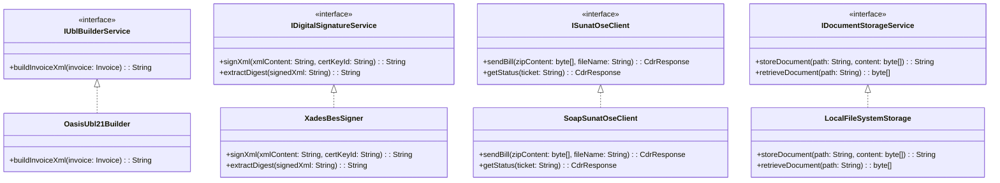
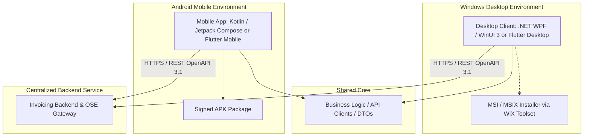

# SPEC 02 — Arquitectura de Software: Monolito MVC y Evolución Hexagonal

**Versión:** 1.0.0  
**Fecha:** 22 de octubre de 2026  
**Fase:** Fase 1 — Especificación Técnica Spec-First  
**Autor:** Senior Software Architect  
**Estado:** BORRADOR — PENDIENTE DE REVISIÓN

---

## 1. Visión General de la Arquitectura

Para satisfacer los requerimientos operativos inmediatos de **ABC Software Corp** y a la vez salvaguardar la escalabilidad futura, se define una estrategia arquitectónica en dos etapas:
1. **Etapa 1 (Base Inicial):** **Monolito Modular con Patrón MVC Limpio.** Se prioriza la simplicidad operativa, el bajo costo de despliegue y una estricta modularidad interna mediante interfaces de abstracción en el núcleo de servicios.
2. **Etapa 2 (Evolución Natural):** **Arquitectura Hexagonal (Ports & Adapters) / Clean Architecture.** Las interfaces definidas en la Etapa 1 se promueven formalmente a Puertos (Ports), permitiendo intercambiar adaptadores de infraestructura (motores de base de datos, clientes SOAP de SUNAT/OSE, motores de firma digital) sin alterar la lógica de negocio ni las reglas tributarias.

---

## 2. Fase Inicial: Monolito Modular MVC

### 2.1 Justificación
Un monolito modular evita la sobreingeniería y complejidad distribuida (fallas de red, consistencia eventual, orquestación de transacciones) en un equipo mediano en fase de regularización tributaria. La clave del diseño radica en **prohibir dependencias directas de la capa de presentación hacia infraestructura o persistencia**.

### 2.2 Descomposición en Capas y Responsabilidades
- **Capa de Controladores (Presentation Layer):** Recibe las solicitudes HTTP/REST o eventos de UI local (`InvoiceController`, `MigrationController`, `InventoryController`), valida sintácticamente los DTOs de entrada (`CreateInvoiceRequest`, `CreateMigrationBatchRequest`), delega la ejecución al servicio de aplicación y retorna DTOs (`InvoiceResponse`, `MigrationBatchResponse`) o códigos HTTP adecuados.
- **Capa de Servicios de Aplicación (Application Services):** Orquesta los casos de uso (`InvoicingService`, `MigrationService`, `InventoryService`), coordina transacciones de base de datos y utiliza interfaces desacopladas.
- **Capa de Dominio (Domain Layer):** Entidades puras (`Invoice`, `InvoiceLine`, `InventoryMovement`, `MigrationBatch`) que contienen las invariantes de negocio, cálculos aritméticos de impuestos (IGV, ISC, ICBPER) y validaciones de estado.
- **Capa de Interfaces de Desacoplamiento (Business Ports / SPI):** Contratos que aíslan el acoplamiento a librerías de terceros y servicios de red.

### 2.3 Interfaces de Desacoplamiento Mandatorias

1. `IUblBuilderService`: Aísla la serialización XML según el estándar OASIS UBL 2.1. Permite modificar las plantillas XML o namespaces sin tocar el dominio de la factura.
2. `IDigitalSignatureService`: Aísla el estándar criptográfico de firma digital XAdES-BES y la gestión del almacén de certificados PKCS#12 (`.p12` / `.pfx`), abstrayendo librerías criptográficas de bajo nivel.
3. `ISunatOseClient`: Aísla la comunicación por protocolo SOAP con los webservices de SUNAT (`billService`) u OSEs autorizadas. Permite alternar entre emitir directamente a SUNAT o derivar a una OSE homologada cambiando únicamente la configuración.
4. `IDocumentStorageService`: Aísla el guardado físico de archivos binarios (XML firmados, CDRs `.zip`, PDFs generados), soportando almacenamiento en disco local en fase monolítica o buckets en la nube en fases posteriores.

El diagrama detallado se encuentra en `specs/diagramas/mvc.puml`.

---

## 3. Hoja de Ruta de Evolución: De MVC a Arquitectura Hexagonal

### 3.1 Proyección hacia Puertos y Adaptadores (Ports & Adapters)
En la evolución hacia Arquitectura Hexagonal:
- **El núcleo (Core)** queda completamente ciego al mundo exterior.
- Los controladores se convierten en **Adaptadores Primarios (Driving Adapters)** que consumen **Puertos de Entrada (Inbound Ports / Use Cases)**: `IRegisterInvoiceUseCase`, `IIssueInvoiceSunatUseCase`, `IMigrateLegacyBatchUseCase`.
- Las interfaces de persistencia, UBL, firma y comunicación externa se convierten en **Puertos de Salida (Outbound Ports / Driven Ports)** implementados por **Adaptadores Secundarios (Driven Adapters)**:
  - Puerto `IInvoiceRepositoryPort` $\rightarrow$ Adaptador PostgreSQL / SQLite.
  - Puerto `IUblGeneratorPort` $\rightarrow$ Adaptador UBL 2.1 JAXB / DOM.
  - Puerto `IDigitalSignaturePort` $\rightarrow$ Adaptador XAdES-BES.
  - Puerto `ISunatOsePort` $\rightarrow$ Adaptador SOAP Client / OSE Client.
  - Puerto `IDocumentStoragePort` $\rightarrow$ Adaptador Local FileSystem / AWS S3 / GCS.

El diagrama completo se encuentra en `specs/diagramas/evolucion-hexagonal.puml`.

### 3.2 Preparación para Microservicios
Cuando el volumen de transacciones de ABC Software Corp escale, el monolito modular y hexagonalizado se podrá particionar limpiamente a lo largo de los límites de sus agregados (*Bounded Contexts*):
1. **Servicio de Facturación Electrónica (CPE Service):** Dominio `Invoice`, emisor, motor UBL, firma y comunicación OSE.
2. **Servicio de Inventario y Almacén (Warehouse Service):** Dominio `InventoryMovement`, `Product`, stock y kardex.
3. **Servicio de Ingesta y Migración (Migration Worker):** Dominio `MigrationBatch`, procesamiento batch asíncrono.

---

## 4. Estrategia de Distribución y Multiplataforma (Windows y Android)

### 4.1 Análisis de Factibilidad y Decisiones de Diseño

#### Modelo Arquitectónico Propuesto: Cliente Ligero Multiplataforma + API Centralizada
1. **Arquitectura Cliente-Servidor Desacoplada:**
   - La lógica pesada de firma digital, comunicación SOAP con SUNAT/OSE, resguardo de certificados PKCS#12 y persistencia relacional se hospeda en el backend central (expuesto mediante la API REST OpenAPI 3.1 definida en `specs/05-endpoints-openapi.yaml`).
   - Los clientes Windows y Android actúan como interfaces ricas de usuario que consumen los contratos DTO estandarizados.

2. **Estrategia Windows (MSI):**
   - **Tecnología sugerida:** Aplicación de escritorio .NET (WPF / WinUI 3) o Flutter Desktop.
   - **Empaquetado:** Generación de instalador estándar de Windows `.msi` mediante WiX Toolset, incluyendo dependencias (.NET Runtime) y configuración de endpoint.

3. **Estrategia Android (APK):**
   - **Tecnología sugerida:** Aplicación nativa Android en Kotlin (Jetpack Compose) o Flutter Mobile.
   - **Empaquetado:** Archivo instalador `.apk` firmado para distribución interna o sideloading en dispositivos POS / smartphones de almacén y vendedores en ruta.

### 4.2 Limitaciones Técnicas y Consideraciones Operativas

| Aspecto | Windows (Escritorio / MSI) | Android (Móvil / Tablet / APK) |
| :--- | :--- | :--- |
| **Resguardo de Certificado Digital** | Posible almacenar archivo `.pfx` en almacén de certificados de Windows (CryptoAPI). Riesgo moderado en equipos compartidos. | **Alto riesgo de seguridad:** No se recomienda almacenar el certificado digital tributario en terminales móviles. La firma debe realizarse en el servidor backend. |
| **Generación y Firma Local** | Alta capacidad de cómputo para procesar XMLs pesados y firmar localmente en contingencia. | Limitaciones de batería y memoria; conectividad intermitente en almacenes requiere cola local con sincronización diferida. |
| **Conectividad a SUNAT / OSE** | Habitualmente en red corporativa cableada/Wi-Fi estable. | Conexión móvil variable (4G/5G/Wi-Fi); propenso a tiempos de espera (timeouts) en llamadas SOAP directas. |
| **Actualizaciones de Software** | El instalador MSI requiere políticas de despliegue corporativo (GPO / SCCM) o módulo de auto-actualización. | La distribución por APK directo requiere habilitar "Orígenes desconocidos" en Android o gestionar MDM corporativo. |

> **Decisión Arquitectónica Clave:** Para garantizar la seguridad del certificado digital y la integridad tributaria, **la firma digital y el envío a SUNAT/OSE se centralizan en el backend de servicios**. Los instaladores MSI y APK proveen la experiencia nativa de captura, consulta, lectura de códigos de barra e impresión de tickets de venta.
